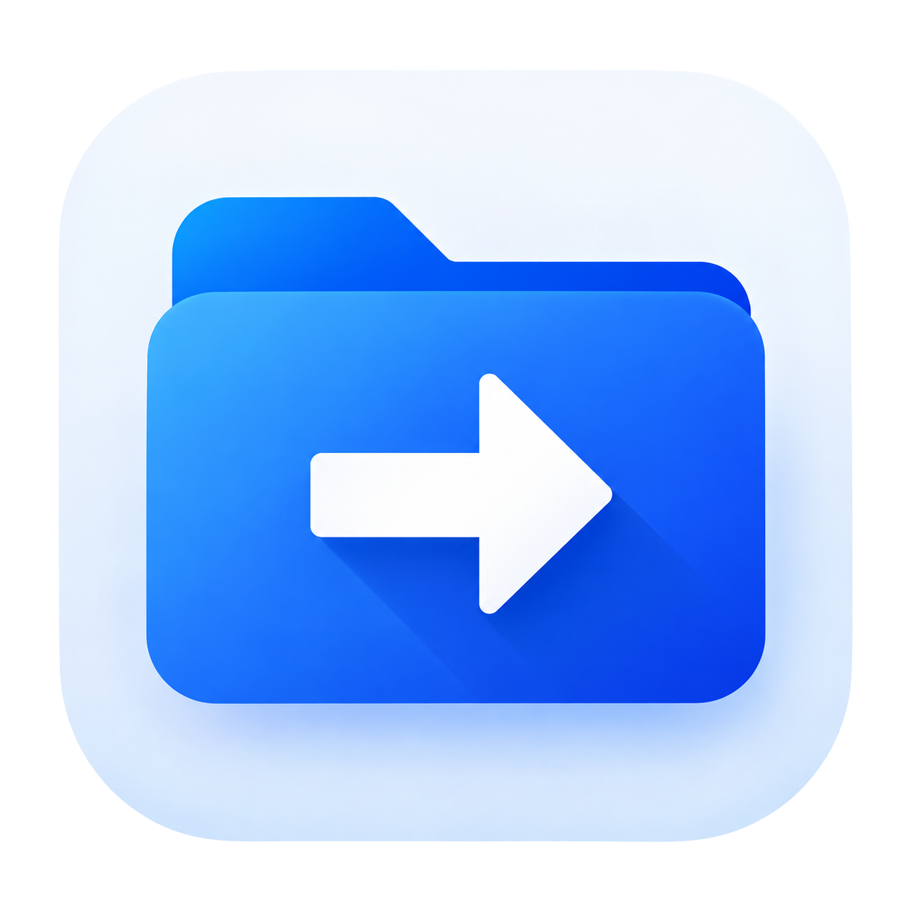

<div align="right">
<a href="README.md">繁體中文</a> ·
<strong>English</strong>
</div>

<div align="center">

<h1>
  
  P2PRemoteFiles
</h1>

**An Android-to-Android remote dual-pane file manager built for assistance and data recovery**


</div>

---

## What is P2PRemoteFiles?

P2PRemoteFiles is a remote file management and recovery tool designed for **Android devices helping other Android devices**.

It is not a remote desktop application and it is not a cloud drive. Every Android device running the app has its own Device ID and can act as either the controller or the controlled device depending on the current session.

The main interface is an MT Manager-inspired **dual-pane remote file manager**. Both panes represent the controlled device, so files can be copied, moved, renamed, deleted or compressed directly on that device without first downloading them to the controller and uploading them again.

For example:

```text
Left pane:  Device B /Android/data/com.example/
Right pane: Device B /USB/Backup/

               Copy →

Actual operation:
Device B internal storage → Device B USB storage
```

The controller only sends the operation request. File contents do not pass through the network or VPS for this kind of remote-to-remote operation on the same controlled device.

---

## Typical use cases

P2PRemoteFiles is intended for situations such as:

- Helping family or friends organize files on an Android phone remotely.
- Copying data from the controlled device directly to its SD card or USB storage.
- Recovering files from a phone whose display or touch input is broken while Android itself is still running.
- Backing up restricted locations such as `Android/data` when the controlled device has the required privileged access.
- Connecting across different networks through a self-hosted VPS instead of relying on a third-party remote-access service.

> The project intentionally focuses on **file management and recovery**. It does **not** provide file previewing, image viewing, video playback, text editing, “Open with”, or similar content-consumption features.

---

## Features

### AnyDesk-style device connection

Every device has a unique Device ID.

The home screen allows you to:

- View your own Device ID.
- Enter another Device ID and connect.
- Discover devices on the same LAN.
- Reconnect to recent devices.
- Manage trusted peers and unattended-access permissions.

Devices on the same LAN are connected directly whenever possible. Devices on different networks can be reached through a self-hosted VPS relay.

### Dual-pane remote file manager

After a connection is established, both panes browse the controlled device independently.

Supported operations include:

- Copy
- Move
- Rename
- Delete
- Create directories
- ZIP compression
  - Store only
  - Normal compression
- File and directory properties
- Permission inspection and editing when the active backend supports it
- Horizontal multi-selection and range selection
- Pull to refresh
- Direct path navigation

### Upload and download

P2PRemoteFiles also supports real cross-device file transfer:

```text
Controller A → Controlled B: Upload
Controlled B → Controller A: Download / Backup
```

On the same LAN, data is transferred directly between A and B. Across different networks, the current implementation relays the encrypted session through the configured VPS.

The VPS **does not save transferred files as temporary files**, although relay traffic consumes both inbound and outbound VPS bandwidth.

### SD cards and USB storage

When removable storage is attached to the controlled device, it appears in the storage drawer.

Selecting a storage device only changes the currently active pane. The other pane remains where it was, making direct internal-storage-to-SD/USB operations convenient.

### Optional thumbnails

Supported image files can display thumbnails in the file list. If thumbnail generation fails, the app falls back to the default file-type icon.

Thumbnail loading can be disabled completely for slow connections, low-powered devices, or recovery scenarios.

---

## File access backends

P2PRemoteFiles selects an available file-access backend according to the controlled device's capabilities.

The current priority is:

```text
Root Shizuku / Sui
        ↓
SU RootService
        ↓
File API
        ↓
Shell Shizuku
```

If Shizuku is required to access a restricted location on the controlled device, **Shizuku must be available on the controlled device**. Shizuku running only on the controller cannot grant filesystem access to another phone.

---

## Unattended and locked-screen access

By default, an incoming connection must be approved on the controlled device.

A trusted peer can optionally be granted individual permissions such as:

- Browse
- Download
- Upload
- File management
- Delete
- Unattended access
- Access while the screen is locked

These permissions are bound to the trusted device identity. Knowing a Device ID alone is not enough to gain access.

When unattended access is enabled, the app can keep its remote service available in the background using a foreground service, including while the screen is off.

### Important limitation

After a device reboot, Android credential-encrypted data is unavailable until the user completes the **first unlock**.

P2PRemoteFiles does not attempt to bypass this Android security boundary. A device that has rebooted and has never been unlocked is considered unavailable for remote file recovery.

---

## Connection model

The VPS is not required for every connection.

```text
Same LAN
   ↓
Direct LAN connection

Different networks
   ↓
VPS discovery and relay
```

The remote filesystem protocol and session are additionally encrypted between the two devices, while the VPS mainly provides discovery and byte relay.

To host your own server, see:

**[SERVER_SETUP.md](SERVER_SETUP.md)**

### Configure your server when building from source

The repository does not hard-code anyone's production VPS domain. Android client endpoints are stored in `p2premotefiles.conf` at the project root.

After cloning the repository for the first time:

```bash
cp p2premotefiles.conf.example p2premotefiles.conf
```

Then edit `p2premotefiles.conf`:

```properties
VPS_SIGNALING_URL=wss://your-domain.example/ws
VPS_RELAY_URL=wss://your-domain.example/relay
```

Gradle reads these values automatically at build time and generates the matching `BuildConfig` fields, so there is no need to edit `app/build.gradle.kts`.

`p2premotefiles.conf` is listed in `.gitignore`, allowing you to keep your real server endpoints locally without including them in normal Git commits. `p2premotefiles.conf.example` stays in the repository as a public template. If the private config file has not been created yet, the project can still build using the example values, but the example domain does not provide a working service.

---

## Permissions and security

This project is intentionally a high-privilege utility. Depending on the desired capabilities, it may use:

- All files access
- Shizuku / Sui
- Root access (optional)
- Foreground services
- Local-network access
- Notification permission

Unattended access and locked-screen access are disabled by default and require explicit approval on the controlled device.

A Device ID is an address, not a password.

---

## Project scope

P2PRemoteFiles is primarily designed for private use among a small number of trusted devices and friends. It is not designed as a large public relay service or an app-store-scale commercial service.

A concise description of the project is:

> **An Android-to-Android remote dual-pane file manager, self-hosted connection service, and data recovery tool.**

---

## Version

Current version: **26.10.01**  
Version Code: **1**
